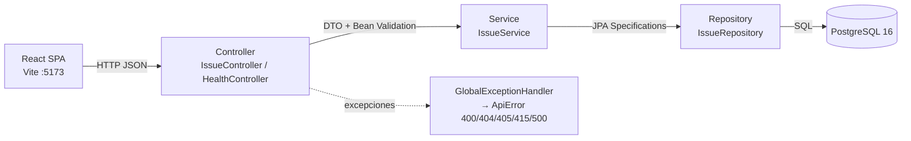

# Arquitectura — BugTrack

Documento orientado a entrevistas y revisión por pares: qué tiene adentro el
proyecto, por qué está diseñado así, y con qué números se prueba. La API se
documenta aparte en [`api.md`](./api.md); el detalle de pruebas, en
[`test-plan.md`](./test-plan.md).

## Quick path

1. Leyéndolo de punta a punta: overview → diagrama → paquetes → decisiones.
2. Para un vistazo rápido: las tablas de **Decisiones clave** y **Test pyramid**.
3. Para verificar claims: `test-plan.md` tiene los resultados reales de cada caso.

## Overview

BugTrack es un gestor de issues (bug tracker) de una sola entidad: la tabla
`issues`. Backend Spring Boot + frontend SPA React consumiéndolo por REST sobre
PostgreSQL. Un MVP deliberadamente chico y cerrado: sin auth, sin usuarios, sin
comentarios — la complejidad está en las decisiones de diseño, no en la cantidad
de features.

## Arquitectura por capas

Patrón clásico controller → service → repository, sin atajos. El frontend nunca
habla con la base ni con JPA: solo consume la API REST.



Recorrido de un `GET /api/issues?status=OPEN`:

1. **Controller** desempaqueta query params (ya convertidos a enums por Spring;
   un valor inválido → 400 antes de tocar la lógica de negocio) y arma DTOs de
   salida con `IssueResponse.from(entity)`.
2. **Service** combina filtros con `Specification` (AND) y ordena por `id DESC`.
   Toda la lógica de negocio vive acá, en métodos `@Transactional`.
3. **Repository** (`JpaRepository` + `JpaSpecificationExecutor`) ejecuta el
   `SELECT` contra PostgreSQL.
4. La entidad vuelve por el service, el controller la mapea a `IssueResponse`
   (timestamps en UTC ISO-8601) y responde 200.

## Mapa de paquetes (backend)

```
com.bugtrack
├── BugTrackApplication.java   punto de entrada Spring Boot
├── config/WebConfig           CORS para el dev server de Vite (:5173)
├── controller/                HTTP: IssueController, HealthController
├── dto/                       contratos de entrada/salida + validación
├── entity/                    mapeo JPA: Issue + enums Severity/Priority/Status
├── exception/                 ResourceNotFoundException, ApiError, GlobalExceptionHandler
├── repository/                IssueRepository (JPA + Specifications)
└── service/                   IssueService (lógica de negocio, @Transactional)
```

Regla de dependencia: `controller → service → repository → entity`. Ninguna
capa mira hacia arriba. Los DTOs no dependen de JPA; la entity no sabe nada de
HTTP.

## Decisiones clave

| Decisión | Alternativa descartada | Por qué |
|---|---|---|
| DTOs dedicados (`IssueRequest`/`IssueResponse`) | Exponer la entity `Issue` | La entity es un artefacto interno de persistencia: exponerla acopla el contrato HTTP al esquema, habilita escritura de campos que no deberían (p. ej. `id`, timestamps) y hace que un refactor de JPA rompa clientes. El DTO además lleva la validación (Bean Validation) y formatea timestamps. |
| `status` ausente en `IssueRequest` | Campo más en el CRUD | El estado solo cambia por `PATCH /{id}/status`. Evita que un `PUT` "resucite" un issue cerrado por accidente y deja el ciclo de vida explícito en la API. |
| `schema.sql` como única fuente de verdad + `ddl-auto: validate` | `ddl-auto: update/create` | `update` esconde cambios de esquema: Hibernate genera DDL divergente de lo que el equipo cree que desplegó, y nadie revisa el DDL real. Con `validate`, si entity y `schema.sql` divergen, **la app no arranca** — el fallo es temprano y ruidoso. El DDL vive en un archivo versionado, revisable en PRs, y se ejecuta idempotente (`CREATE TABLE IF NOT EXISTS`) con `spring.sql.init`. |
| Enums Java + `CHECK` en SQL | Solo un lado | Doble validación a propósito: Bean Validation rechaza entradas inválidas con 400 y mensajes útiles para el cliente; el `CHECK` es la red de seguridad en la base por si algo entra por otro camino (un script manual, un cliente SQL directo). Java y SQL validan lo mismo: `LOW/MEDIUM/HIGH/CRITICAL`, etc. |
| Timestamps generados en backend en UTC (`@CreationTimestamp`/`@UpdateTimestamp`) | `DEFAULT now()` del lado del servidor de BD, o timestamps del browser | Una sola autoridad: la JVM con `hibernate.jdbc.time_zone: UTC` y columnas `TIMESTAMPTZ`. El browser nunca manda fechas (manejo de zonas inconsistente); `DEFAULT now()` en SQL queda solo como safety net. El DTO emite ISO-8601 con offset UTC. |
| Errores centralizados en `GlobalExceptionHandler` | Excepciones tiradas desde cada controller / respuestas ad-hoc | Un solo `@RestControllerAdvice` traduce excepciones a un cuerpo uniforme `ApiError` (`timestamp`, `status`, `message`, `fieldErrors?`). El catch-all `Exception → 500` **no filtra internals** (ni stack traces ni mensajes de Hibernate) al cliente. |
| Filtros con `JpaSpecificationExecutor` | Queries JPQL con `AND` condicional por cada combinación | Las Specifications componen predicados en runtime: agregar un cuarto filtro no duplica métodos de repository. |
| `DELETE /{id}` sin UI | No exponer DELETE | Existe para que los E2E limpien datos entre corridas y sean reproducibles. Es solo-API, documentado como tal. |

## Manejo de errores

| Código | Cuándo | Ejemplo de cuerpo |
|---|---|---|
| 400 | Bean Validation falla (`fieldErrors`) o parámetro/enum inválido o body malformado | `{"timestamp":"…","status":400,"message":"Validation failed","fieldErrors":{"title":"title must not be blank"}}` |
| 404 | Id inexistente (`ResourceNotFoundException`) | `{"timestamp":"…","status":404,"message":"Issue 999999 not found"}` |
| 405 | Verbo HTTP no soportado en la ruta | `{"…","status":405,"message":"Method DELETE not supported for this endpoint"}` |
| 415 | Content-Type que no es `application/json` | `{"…","status":415,"message":"Content-Type must be application/json"}` |
| 500 | Cualquier excepción no contemplada | `{"…","status":500,"message":"An unexpected error occurred"}` — sin detalles internos |

Detalle de cuerpos y ejemplos por endpoint: [`api.md`](./api.md).

## Test pyramid

Pirámide corta y honesta, con números reales de corridas (ver
[`test-plan.md`](./test-plan.md) para el detalle por caso):

| Nivel | Herramienta | Base real | Casos | Pasó |
|---|---|---|---|---|
| Unitarias | JUnit 5 + Mockito (`IssueServiceTest`) | No (mocks) | 17 | 17 / 0 falló |
| Integración | `@SpringBootTest` (`IssueApiIntegrationTest`) | Sí (PostgreSQL `bugtrack_test`) | 21 | 21 / 0 falló |
| E2E | Cypress (`frontend/cypress/e2e/`) | Sí (backend + frontend + PostgreSQL) | 13 | 13 / 0 falló |
| **Total** | | | **51** | **51 / 0 falló** |

- Las unitarias cubren la lógica del service y la validación de los DTOs.
- Las integraciones ejercitan el stack completo (controller → repository →
  Postgres real) con `ddl-auto: validate`, o sea: validan el mapeo contra el
  `schema.sql` real, no contra un H2.
- Las E2E prueban los flujos de usuario completos (crear → editar → cambiar
  estado → filtrar) contra backend y frontend levantados de verdad.

CI (`.github/workflows/ci.yml`) repite las tres capas en cada push/PR a `main`.

## Stack y versiones

| Componente | Versión | Nota |
|---|---|---|
| Java | 21 (Temurin) | LTS; records y `instanceof` patterns disponibles |
| Spring Boot | 3.3.5 | `spring-boot-starter-web`, `-data-jpa`, `-validation` |
| Hibernate | 6.5.3.Final | (traído por Boot; solo `validate`, sin generación de DDL) |
| Maven | 3.9.x | Build backend |
| PostgreSQL | 16 | Local en puerto 5436; CI en 5432 |
| Node.js | 20+ (CI: 24) | Frontend tooling |
| Vite | 8.x | Dev server :5173 + build de producción |
| React | 19.x | SPA con React Router 7 |
| Cypress | 16.x | E2E headless (Electron) |

## Limitaciones (a propósito del MVP)

- Sin autenticación/autorización: cualquier cliente puede leer y escribir.
- Una sola entidad: no hay usuarios, proyectos ni comentarios.
- Sin paginación: `GET /api/issues` devuelve todo el listado.
- Timestamps se emiten en UTC; el frontend los formatea sin conversión de zona.

Próximos pasos posibles (fuera del alcance actual): auth por JWT, comentarios,
asignación a usuarios, paginación y deploy.
